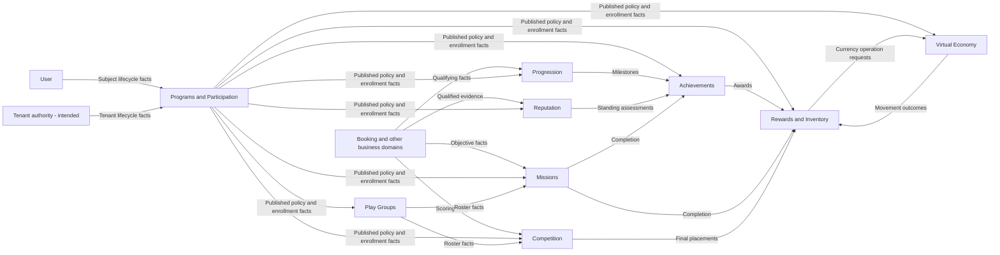
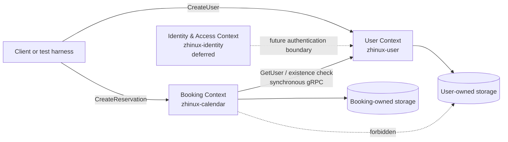

# Zhinux Bounded Contexts

- Status: Active
- Last reviewed: 2026-10-29
- Scope: Existing User/Booking boundaries and Lab 4 flow; planned gamification domains and context index

## Purpose

This document defines ownership, language, and integration rules for Zhinux bounded contexts. It preserves the existing User/Booking boundaries and Lab 4 flow, and indexes the planned gamification domain family. Its primary goal is to let contexts evolve independently without transferring domain ownership.

The [gamification context index](#gamification-domain-family-and-context-index) describes domain boundaries and concepts only; it makes no deployment decisions.

## Gamification Domain Family and Context Index

- Status: Planned domain design; no implementation or deployment topology is implied.
- Reviewed: 2026-10-29
- Module: [`zhinux-gamification`](../../zhinux-gamification/README.md)
- Domain family: **Engagement & Motivation**.

Gamification interprets authoritative activity from Zhinux business domains to provide game-like experiences across products. It owns its own policies and outcomes; it does not become part of User, Identity & Access, or Booking. The module groups nine dedicated bounded contexts with distinct models and ownership. These boundaries describe domains, not deployments.

| Subdomain | Bounded context | Authoritative responsibilities and concepts |
| --- | --- | --- |
| Program governance | Programs & Participation | Program, Participant, Enrollment, EligibilityPolicy, RuleVersion; program lifecycle, scope, enrollment, eligibility, and policy publication |
| Progression | Progression | ProgressTrack, XPGrant, ParticipantProgress, LevelCurve, MasteryNode, Streak, Milestone, Unlock; non-spendable experience and advancement |
| Trust and standing | Reputation | ReputationDimension, ReputationEvidence, ReputationPolicy, ReputationAssessment, ReputationAdjustment; evidence-based standing, disputes, decay, and corrections |
| Recognition | Achievements | AchievementDefinition, AchievementAward, Badge, Title, Collection; qualification, award uniqueness, repeatability, and revocation |
| Objectives and challenges | Missions | MissionDefinition, MissionRun, Objective, MissionParticipation, Challenge, CooperativeObjective; objective progress, recurrence, limited-time events, and completion |
| Competitive play | Competition | Competition, ScoreEntry, Leaderboard, Rank, Season, League, Division, Placement; scoring, cohorts, tie-breaking, finalization, promotion, and demotion |
| Virtual economy | Virtual Economy | CurrencyDefinition, Wallet, LedgerEntry, Transfer, Hold, ExchangePolicy, ExpiryLot; multiple currencies, balances, spending, transfers, exchange, expiry, and reversals |
| Reward fulfillment | Rewards & Inventory | RewardDefinition, RewardGrant, Claim, Redemption, InventoryItem, Gift, BoosterActivation; catalog, grants, claims, virtual holdings, gifting, and consumption |
| Cooperative play | Play Groups | PlayGroup, Clan, Membership, GroupRole, GroupParticipation; game-specific groups, invitations, membership lifecycle, and roster facts |

Definitions, scheduled runs, participant progress, and issued awards are different concepts. Referencing the same participant across contexts does not establish a shared aggregate or persistence model. Detailed policies and invariants are in the [module README](../../zhinux-gamification/README.md).

### Gamification Semantic Context Map



Edges identify semantic contracts only. Contexts consume only outcomes enabled by explicit policies. Identity & Access governs authenticated access; it does not calculate XP, reputation, scores, or awards. Programs publishes applicable enrollment/policy facts; each downstream context owns interpretation and enforcement of its local policy. No arrow implies shared storage or a required synchronous dependency.

### Gamification Language and Currency Rules

| Concept | Meaning and boundary |
| --- | --- |
| XP | Non-spendable advancement within a Progression track |
| Level | Advancement classification from XP and a versioned level curve |
| Reputation | Evidence-based trust, quality, or reliability in a Reputation dimension; independent of XP and levels |
| Score / rank | Competition-specific performance / relative standing; neither is XP or an access role |
| League / division | Competitive grouping, not a platform role or a customer subscription tier |
| Virtual currency | Explicitly identified spendable unit governed by Virtual Economy |
| Points / stars | Display labels; classify explicitly as advancement, score, recognition, or currency |
| Skill / mastery | Gamified progression; actual competencies and credentials remain with their external authorities |
| Event | Qualify as integration event, gamification event/run, or scheduled gathering |
| Clan / collaboration | Game-specific Play Group or cooperative mission; general communities and business collaboration remain external |

Multiple virtual currencies are a first-class capability:

- Identify a currency by tenant-scoped immutable ID with a tenant-unique code, precision, lifecycle, and versioned economic policy. Names such as gems, coins, and stars are presentation metadata, not interchangeable units.
- Identify a wallet account by tenant, economy scope, participant, and currency ID. Economy scope determines whether a balance is isolated to one program or explicitly shared by named programs within the tenant.
- Maintain independent balances and policies for issuance, spending, transfers, holds, expiry, caps, balance limits, and overdrafts. Never sum or substitute different currencies implicitly.
- Use exact amount arithmetic and immutable, traceable ledger movements. Available balances account for holds; refunds and corrections append compensating movements.
- Currency exchange requires an explicit pair policy and recorded quote/rate, rounding, fees, limits, and coordinated debit/credit outcome. Exchange is not implied by supporting multiple currencies.
- Multi-currency prices identify every required amount. Rewards coordinates redemption, reservations, capture/release, and fulfillment acknowledgment with Virtual Economy and any external benefit owner.
- Reputation cannot be purchased, transferred, spent, or booster-amplified by default. XP and levels remain distinct from reputation and all currencies.

### Cross-Module Responsibilities

| Module or domain | Relationship to Gamification |
| --- | --- |
| `zhinux-user` | Owns user registry, profile attributes, and user lifecycle; profiles may display composed gamification summaries |
| `zhinux-identity` | Owns credentials, authentication, and access; gamification unlocks do not automatically become permissions |
| `zhinux-calendar` | Owns reservations, conflicts, and booking facts; scheduled gatherings stay with Calendar/Booking |
| `zhinux-tenant` | Intended tenant authority; detailed ownership/contract still requires definition |
| `zhinux-asset` | Intended media boundary for badge artwork and reward imagery; gamification owns award meaning and asset references |
| `zhinux-contracts` | Owns API/event schema location, not gamification business policy or shared aggregates |
| `zhinux-platform` / `zhinux-kv` | Technical utilities / intended storage capability; neither becomes owner of progress, reputation, or balances |
| Learning/Skills, Community/Organization, Commerce/Payments, Fulfillment | External domain boundaries for real competencies, general groups, money, and actual benefits; not new modules established by this map |
| Notifications / Analytics | External consumers for delivery and analysis; those capabilities are not assigned to an existing placeholder module here |

### Integration, Corrections, and Lifecycle

- Business domains publish facts; gamification evaluates versioned earning, objective, reputation, and scoring policies. Source domains do not need to calculate gamification rewards.
- Inputs retain source event ID, tenant/program scope, subject, occurrence time, schema version, and causation. Outcomes retain applied policy version and source evidence.
- Deduplication is scoped to source, rule/version, recipient, and outcome. Duplicate delivery, out-of-order activity, and replay must not duplicate awards, currency movements, or gifts.
- Definition changes have effective dates and explicit retroactivity rules. Rebuilding projections is distinct from granting new outcomes.
- Each context defines reversal/compensation semantics, including invalidated reputation evidence, spent/expired rewards, and corrected competition results.
- Define opt-out, suspension, deletion, retention, leaderboard visibility, roster changes, earning caps, cooldowns, disputes, and manual-adjustment audit reasons.
- A gamification failure must not invalidate an otherwise valid source-domain action. Cross-context fulfillment tracks durable intent, acknowledgment, and recovery rather than assuming atomic global completion.
- No context reads another's tables or imports another's internal model. Cross-context concepts are mapped through published contracts.

The existing Lab 4 flow and its event deferral remain unchanged. These planned contexts do not introduce gamification into that lab's mandatory request path.

## Lab 4 Simplification

The Lab 4 specification names two contexts:

- `identity` for users and tenants.
- `booking` for reservations and conflicts.

Zhinux's intended long-term architecture is more precise:

- `zhinux-user` owns user registry and profile concerns.
- `zhinux-identity` owns authentication and access concerns.
- `zhinux-calendar` owns booking and reservation concerns.

To preserve Lab 4's two-service scope, its simplified `identity` role maps to `zhinux-user`. The Lab 4 runtime is therefore:

- User context: `zhinux-user`.
- Booking context: `zhinux-calendar`.

`zhinux-identity` is explicitly out of scope for this lab. It should not be added merely to satisfy the word “identity” in the lab brief. Authentication, passwords, sessions, tokens, and authorization are separate future capabilities.

## Context Map



## Context Ownership

### User Context

Repository: `zhinux-user`

Owns:

- User identity within the product's user registry.
- User lifecycle and existence.
- Profile attributes such as phone, name, username, and email.
- Uniqueness rules for user-owned identifiers.
- User persistence schema.
- Public User gRPC behavior.

Does not own:

- Password verification, login sessions, or token issuance.
- Reservation eligibility rules beyond exposing authoritative user state.
- Venues, schedules, or reservation conflicts.

### Booking Context

Repository: `zhinux-calendar`

Owns:

- Reservations.
- Venue identifiers as understood by Booking.
- Time ranges and slot invariants.
- Conflict detection.
- Reservation idempotency behavior.
- Booking persistence schema.
- Public Booking gRPC behavior.

Does not own:

- User profiles or credentials.
- Authentication or token issuance.
- User persistence.
- The meaning of User fields beyond the minimum Booking eligibility contract.

### Identity & Access Context

Repository: `zhinux-identity`

Long-term ownership:

- Credentials and authentication.
- Login and logout.
- Access and refresh tokens.
- Account authentication state and security policy.

Lab 4 status: deferred and not part of the create-user → create-reservation flow.

## Ubiquitous Language

| Term | Owning context | Meaning |
| --- | --- | --- |
| User | User | A registered product user with a stable `UserID` |
| UserID | User; referenced by Booking | An opaque identifier issued by User |
| Reservation | Booking | A request accepted for one user, venue, and slot |
| VenueID | Booking | The Booking identifier of a reservable venue |
| Slot | Booking | A venue-specific half-open time interval |
| Conflict | Booking | An overlap violating Booking rules |
| Identity | Identity & Access | Authentication and credential state, not a profile synonym |
| Principal | Identity & Access | An authenticated actor represented by credentials |

Booking may reference a `UserID`, but that does not transfer ownership of the User concept to Booking.

## Integration Contract

### Lab 4 Synchronous Flow

1. A client calls User to create a user.
2. User validates its invariants and stores the user.
3. A client calls Booking to create a reservation with that `UserID`.
4. Booking calls User through a generated gRPC client to verify existence.
5. Booking loads existing reservations from its own repository.
6. Booking applies reservation and conflict rules.
7. Booking stores the accepted reservation in its own repository.

The decision and trade-offs are recorded in `docs/adr/0001-booking-user-validation.md`.

### Contract Ownership

Cross-service API and event schemas live in `zhinux-contracts`.

Rules:

- Services import generated contract packages, never another service's internal packages.
- Proto messages are transport contracts, not shared domain models.
- Each gRPC adapter maps proto messages to local application or domain types.
- Breaking contract changes require a new version.
- Events are deferred for the Lab 4 mandatory path.

## Allowed Dependencies

Booking may depend on:

- Generated `user.v1` contract code.
- A local `UserExistenceChecker` or equivalent outbound port.
- A gRPC adapter implementing that port.
- Shared technical utilities from `zhinux-platform` when they do not contain business concepts.

User may depend on:

- Generated `user.v1` contract code.
- Its own local domain, application, ports, and adapters.
- Shared technical utilities from `zhinux-platform`.

## Forbidden Dependencies

The following are architectural violations:

- Booking reading or writing User tables.
- User reading or writing Booking tables.
- Importing `zhinux-user/internal/...` from Booking.
- Importing `zhinux-calendar/internal/...` from User.
- Sharing ORM entities or persistence models.
- Placing User and Reservation aggregates in a shared library.
- Using `zhinux-contracts` as a home for business logic.
- Adding `zhinux-identity` to the Lab 4 request path without a distinct authentication requirement.

## Consistency Model

Lab 4 uses synchronous validation:

- User existence is strongly checked at reservation request time.
- Booking fails closed when User cannot be reached.
- Booking owns the final conflict and acceptance decision.
- Booking stores only the opaque `UserID`; it does not cache the User profile.

Later event-driven projections will be eventually consistent and require explicit policies for lag, replay, deletion, and suspension.

## Code-Level Enforcement

Each service should maintain:

- A domain package with no gRPC, database, or message-broker imports.
- An application service that depends on local ports.
- A gRPC adapter responsible for proto mapping.
- A repository adapter owned by that service.
- Tests that use fakes at port boundaries.

Recommended Booking port:

```go
type UserExistenceChecker interface {
    Exists(ctx context.Context, userID string) (bool, error)
}
```

The exact name may change, but the dependency direction must remain Booking application → Booking-owned port ← User gRPC adapter.

## Lab 4 Proof Checklist

- [ ] User and Booking run as separate processes.
- [ ] Create user → create reservation succeeds.
- [ ] An unknown user cannot create a reservation.
- [ ] Booking never accesses User storage.
- [ ] Neither service imports the other's internal packages.
- [ ] Unit tests prove domain and application behavior.
- [ ] An integration test proves the gRPC boundary.
- [ ] Service boundary docs remain synchronized with this document.

## Future Evolution

Labs 5–7 may add:

- `UserCreated` and user lifecycle events.
- A Booking-owned user eligibility projection.
- NATS and JetStream delivery.
- Retry, dead-letter, outbox, and idempotent-consumer behavior.

Those capabilities should extend this boundary rather than weakening service ownership.
